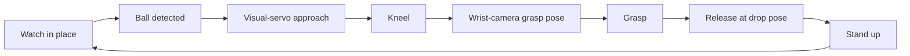

<h1 align="center">TRON2 Visual Grasping</h1>

<p align="center">
  <b>See it, walk up to it, kneel, and pick it up.</b><br>
  Vision-guided mobile grasping for the LimX Dynamics TRON2, running entirely on the CPU.
</p>

<p align="center">
  <a href="https://github.com/limxdynamics/tron2_visual_grasp/actions/workflows/ci.yml"></a>
  
  
  
  
  
</p>

<p align="center">
  <a href="./README_zh.md">简体中文</a> | <a href="./README.md">English</a>
</p>

<p align="center">
  
  <br><sub>One full pick cycle in the hardware-free demo (<code>./run.sh demo</code>), simulated with the official TRON2 model.</sub>
</p>

TRON2 watches the floor with its wrist RealSense D405, drives itself up to the target, kneels,
locks the grasp onto the object with the same camera, drops it off, stands back up, and goes
back to watching for the next one. The first built-in target is the **tennis ball**; more object types
are on the way.

## ✨ Highlights

- **End-to-end mobile pick, on a loop**: watch → visual-servo approach → kneel → wrist-camera grasp → drop → stand up → repeat.
- **No GPU, no neural network**: the detector is pure OpenCV (HSV colour + round-contour filtering), so it runs on a laptop or a Jetson CPU with zero model downloads.
- **Closed-loop grasping**: the wrist camera keeps detecting while the arm moves and steers onto the latest position, so a ball that rolls a little is still caught.
- **One-command hand-eye calibration**: the arm walks through 26 poses around an ArUco marker on its own, solves, and a second command verifies the result.
- **Live web console**: camera streams, mission status and a Stop button in the browser, plus live HSV / exposure sliders for tuning the detector on site.
- **Try it without hardware**: `./run.sh demo` runs the full mission on a simulated TRON2 and wrist camera, viewed in the browser.
- **Hardware behind clean interfaces**: robot and camera drivers sit behind one contract each; TRON2 and an AgileX PiperX arm are supported today.

## 🚀 Quick start

### Try it without a robot

No TRON2 or camera needed: the demo runs the real mission code on a simulated robot and wrist camera.

```bash
git clone https://github.com/limxdynamics/tron2_visual_grasp.git
cd tron2_visual_grasp
conda env create -f environment.yml    # creates the 'tron2_visual_grasp' env
./run.sh demo                          # then open http://localhost:8888/
```

The web console shows a 3D view of TRON2 (its official model from [tron2-robot-description](https://github.com/limxdynamics/tron2-robot-description), downloaded on first run, about 50 MB) next to a top view and the rendered wrist-camera image. The simulated robot spots a ball, drives up to it, kneels, tracks the ball with the arm and picks it up. Then it stands up and goes after the next ball, until you press **Stop** or Ctrl+C. Detection, grasp solving and the mission are the same code that runs on the robot. Only the drivers are simulated, with simple kinematics and no physics. `./run.sh demo --cycles 3` stops after three balls.

### On the robot

> [!WARNING]
> This code drives a real robot, and most commands move it **as soon as they connect**. Read [Safety](#safety) first and keep the emergency stop within reach.

```bash
./run.sh pose       # 1. robot is reachable (read-only)
./run.sh detect     # 2. balls are detected reliably (robot stays still)
./run.sh calib      # 3. hand-eye calibration (required once)
./run.sh dry-run    # 4. grasp point looks right (robot stays still)
./run.sh grasp      # 5. the real thing
```

Open `http://<host-ip>:8888` during `dry-run` or `grasp` to watch the camera views and tune detection live.

## 🧭 How it works



1. **Watch**: the arm holds a look-ahead pose and the detector scans each frame.
2. **Approach**: a 2D visual servo steers the base until the target sits at the right spot in the image.
3. **Kneel and look down**: the robot kneels and pitches its body so the wrist camera sees the target from above.
4. **Grasp**: depth + hand-eye calibration give the grasp pose in the robot base frame; the arm closes in while tracking the target.
5. **Drop and repeat**: the object is released at the drop pose, the robot stands up and starts watching again.

## 🗺️ Roadmap

- [x] Tennis-ball pickup on TRON2 with a wrist D405
- [ ] More object types beyond tennis balls

Ideas and requests are welcome in the [issues](../../issues).

## 🔗 Related LimX Dynamics projects

| Project | What it is |
|---------|------------|
| [tron2_env](https://github.com/limxdynamics/tron2_env) | Gym-style TRON2 runtime: WebSocket transport, motion control, multi-camera observation |
| [tron2_openpi](https://github.com/limxdynamics/tron2_openpi) | OpenPI (π0.5) policy serving and fine-tuning for TRON2 manipulation |
| [TRON2_YG_LAB](https://github.com/limxdynamics/TRON2_YG_LAB) | Isaac Lab RL training for TRON2A with 6-DoF arm and gripper |
| [tron2-robot-description](https://github.com/limxdynamics/tron2-robot-description) | URDF / MJCF / USD models for TRON2A |

---

## 📖 Documentation

- [Hardware](#hardware)
- [Safety](#safety)
- [Installation](#installation)
- [Commands](#commands)
- [Ball detection](#ball-detection)
- [Hand-eye calibration](#hand-eye-calibration)
- [Grasp mission](#grasp-mission-grasp)
- [Layout](#layout)
- [Troubleshooting](#troubleshooting)
- [Known limitations](#known-limitations)
- [Support and contributing](#support-and-contributing)
- [License and acknowledgements](#license-and-acknowledgements)

### Hardware

| Component | Model |
|-----------|-------|
| Robot | TRON2 (upper-layer WebSocket API, default `10.192.1.2:5000`) |
| Gripper | AgxGripper |
| Camera | Intel RealSense D405 (wrist, USB 3.0) |
| Host | Ubuntu 22.04 (x86_64 or Jetson) |

If the camera hits permission errors on first use, install Intel's udev rules for RealSense devices and replug the camera:

```bash
sudo curl -fsSL -o /etc/udev/rules.d/99-realsense-libusb.rules \
  https://raw.githubusercontent.com/IntelRealSense/librealsense/v2.58.4/config/99-realsense-libusb.rules
sudo udevadm control --reload-rules && sudo udevadm trigger
```

### Safety

This code drives a real robot. Read this section before running anything other than `dry-run`, `pose` and `detect`.

- **There is no software emergency stop.** Ctrl+C and the web page's Stop button are not emergency stops. Keep the robot's own emergency stop within reach and keep people out of the work area.
- **Commands move the robot as soon as they connect, without asking.** `grasp` moves the arm to `mission.watch_joints` right away; `home` moves to the requested pose; `calib` and `verify` step the wrist through up to 26 poses around its current pose, orbiting the marker with tilts of up to ~0.22 rad and shifts of up to ~0.12 m.
- **`config/default.yaml` holds the values tuned on our robot, several close to the hardware limits**: `robot.tron2.speed_percent: 100`, `robot.tron2.joint_speed_rad_s: 3.0` (the arm's joints top out around 3.1 rad/s), wrist tracking at up to 0.8 m/s and 3.0 rad/s (`grasp_pipeline.grasp.tracking`), base approach at up to 0.6 m/s and 0.7 rad/s (`mission.approach.control`), and `mission.repeat: true`, which loops until stopped. Lower them for first runs.
- **The base drives itself toward whatever the detector accepts.** Detection uses colour and shape only, so any yellow-green round object can start the approach, and nothing detects obstacles or people. Run it only in a cleared area.
- **Some values belong to our robot.** Check `robot.tron2.accid` (`null` learns it from the robot), `robot.tron2.prepare_ee_pose`, `calibration.aruco.marker_length_m`, `mission.watch_joints` and `mission.drop_joints` before the first run.
- **What the TRON2 driver guards against** ([drivers/robot/tron2_driver.py](drivers/robot/tron2_driver.py)): it refuses to send non-finite (NaN / inf) targets, caps every base twist at `robot.tron2.max_twist_mps` / `max_twist_rps`, ignores malformed replies instead of using them as the measured pose, pauses the arm stream when pose feedback goes stale, and stops with an error when the connection drops. These are software guards, not a safety system: they do not replace the emergency stop.

#### Stopping

- **Ctrl+C** takes effect promptly and runs a cleanup:
  - `grasp`: the base is commanded to stop; if a kneel was requested and the robot has not stood up yet, the arm folds to `robot.tron2.park_joints` and the robot stands up (it stays kneeling if the arm cannot park); finally the arm folds to the park joints (if not already there) and the robot disconnects. A second Ctrl+C during this cleanup abandons it, which can leave the robot kneeling.
  - `calib` / `verify`: the arm folds to the park joints and the robot disconnects; `calib` then solves with the samples collected so far.
  - `home`: commands stop and the arm holds where it is.
- **The web Stop button** (and `q` / Esc in a `--display` window) is acted on only at the next check: while watching, approaching, detecting with the wrist camera, or tracking. It does not interrupt a kneel, pitch or stand and their waits (up to `robot.tron2.posture_timeout_s` plus the `mission.posture` dwell times), an arm move, or the drop. After a stop, `grasp` runs the same cleanup as Ctrl+C.
- **`kill <pid>` (SIGTERM) or closing the terminal** ends the process at once with no cleanup; the arm and body stay as they are, possibly kneeling. `kill -INT <pid>` runs the Ctrl+C cleanup, unless the process was started with SIGINT ignored (for example with `&` from a non-interactive script).
- Once commands stop arriving, the robot relies on its controller: per the notes in [drivers/robot/tron2_driver.py](drivers/robot/tron2_driver.py), the arm latches a hold after its 0.2 s command timeout, and the base stops when `request_twist` goes quiet. Confirm this on your robot.

#### Web debug page

`grasp`, `dry-run`, `calib` and `verify` serve a debug page on port 8888, on every network interface and without authentication. Anyone who can reach it can watch the camera streams and press its buttons (Stop; Capture / Finish during calibration); on `grasp` / `dry-run` they can also change the HSV thresholds and camera exposure, and with them what the robot drives toward. Use it only on a trusted network, or turn it off with `--web-port 0` (or `mission.web_port: 0` for `grasp` / `dry-run`).

### Installation

```bash
git clone https://github.com/limxdynamics/tron2_visual_grasp.git
cd tron2_visual_grasp
conda env create -f environment.yml    # creates the 'tron2_visual_grasp' env
```

`run.sh` finds the `tron2_visual_grasp` env through `conda info --base`; set `TVG_PYTHON=/path/to/python` to use another interpreter.

### Commands

Launch everything with `./run.sh <command>`, never `python scripts/...` directly.

> [!WARNING]
> Every command except `demo`, `dry-run`, `pose`, and `detect` moves the robot as soon as it connects, without asking. Read [Safety](#safety) first and keep the emergency stop within reach.

| Command | Purpose |
|---------|---------|
| `demo [--cycles N]` | Hardware-free demo: the full `grasp` mission on a simulated TRON2 and wrist camera (no robot, no camera) |
| `pose [--watch]` | Print joint angles and TCP pose (read-only) |
| `detect` | Camera + ball detection preview; left-click samples depth |
| `home [--pose park\|ready\|watch] [--open-gripper]` | Move the arm to a resting pose |
| `calib [--manual]` | Hand-eye calibration capture and solve |
| `verify` | Hand-eye calibration check |
| `dry-run` | Perception and grasp-pose estimation only, robot stays still |
| `grasp` | Watch in place → approach → kneel and grasp → release → stand up, repeating |
| `shell <script>` | Run any script in the project environment |

### Ball detection

The detector lives in [utils/opencv_tennis.py](utils/opencv_tennis.py); its parameters are under `detection.tennis` in `config/default.yaml`:

| Key | Meaning |
|-----|---------|
| `hsv_lower` / `hsv_upper` | HSV range of the yellow-green felt (H 0–179, S/V 0–255) |
| `min_area_px` / `max_area_fraction` | Reject tiny noise and large background blobs |
| `min_aspect_ratio` / `min_circularity` / `min_solidity` / `min_circle_fill` | Shape must be close to a circle |
| `min_colour_fraction` | Share of in-range pixels inside the contour |
| `max_det` | Max candidates kept per frame |

`detection.conf_threshold` thresholds the mean of these shape scores. Balls touching the image border are dropped, since a clipped silhouette gives an unreliable centre and size.

**Tuning on site**: the `grasp` / `dry-run` debug page (`http://<host-ip>:8888`) has live sliders for the HSV bounds and camera exposure. Changes only last for the running process; copy good values back into the config.

### Hand-eye calibration

1. Print [aruco100x100.pdf](aruco100x100.pdf) at 100 % (actual size, no fit-to-page); it holds OpenCV `DICT_4X4_50` marker id 0 with a 100 mm black square. Lay it flat in view, measure the outer edge of the black border with calipers, and set `calibration.aruco.marker_length_m` (the shipped 0.096 m was measured on our own print).
2. Run `./run.sh calib`: the arm steps through 26 poses around its current pose and samples automatically (≥5 samples to solve, ≥15 recommended); `--manual` switches to hand guiding (PiperX only; TRON2 has no hand guiding). The result is saved to `config/calibration/realsense_d405/hand_eye.npz`.
3. Run `./run.sh verify` to check it.
4. If grasps still show a constant offset, fine-tune x / y / z (meters) in `calibration.hand_eye_compensation_m`.

### Grasp mission (`grasp`)

Implemented in [scripts/squat_grasp.py](scripts/squat_grasp.py), configured under `mission`:

| Key | Meaning |
|-----|---------|
| `watch_joints` | Arm joints while watching for a ball |
| `detect_on_frames` / `detect_window_frames` | Frames with a ball in view before acting |
| `approach` | Visual-servo approach; with `enabled: false` the base never moves and the ball must already be within reach of the squatted arm |
| `posture` | WF kneel/stand settling times, body pitch and pitch settling time |
| `drop_joints` | Pose where the ball is released before standing up; `null` releases at the park pose |
| `repeat` | Return to watching after each cycle |
| `web_port` | Debug page port |

Grasp-pose parameters (pre-grasp offset, insertion depth, minimum height, jaw orientation) are under `grasp_pipeline.grasp`.

The squat uses `request_wf_stand_kneel` with `data.action: kneel` / `stand`, not
height increments. The body pitches
only after the kneel has finished (`kneel_dwell_s`): the driver first resets the
pitch setpoint, waits `pitch_reset_dwell_s`, then sets `body_pitch_rad` and waits `pitch_dwell_s`. Pitch is
relative and the WF stand levels the body without clearing it, so without that
reset a second-cycle pitch never moved. No pitch reset is sent before standing.
Requests use `robot.tron2.accid` (must match the robot's `notify_robot_info`; `null` learns it automatically), a fresh GUID and a
current millisecond timestamp. The driver waits for `response_wf_stand_kneel`
with the same GUID and `data.result: success`; rejection or timeout
(`robot.tron2.posture_timeout_s`, default 30 s) raises an error. The ball is
dropped while still kneeling (drop pose, release), then the arm parks and the
robot stands. The WF stand takes the arm away from this program's stream: a
joint move the arm ignores after a stand reconnects the WebSocket and retries for
up to `robot.tron2.arm_reacquire_timeout_s` (default 15 s). Exit cleanup also attempts to stand if kneeling failed
or timed out. Neither posture API reports when the body stops moving: grasping
starts only after `kneel_dwell_s` + `pitch_dwell_s`, so tune them on hardware,
and recheck grasp height limits for the new posture.

Common options: `--target-class <name>`, `--display` (local preview windows), `--web-port <port>` (`0` disables the page), `--grasp-timeout <s>`, `--cycles <n>` (stop after n cycles), `--config <path>`. `GRASP_DEBUG=0` silences the transform dump printed for each grasp solve.

**Simulation (`demo`)**: `--sim` (what `./run.sh demo` passes) swaps in the drivers under [drivers/sim/](drivers/sim/):
- **Wrist camera:** rendered from the arm pose, a floor plus a tennis ball with RGB and depth.
- **TRON2:** kinematic, covering the base twist, kneel/stand and body pitch, the arm (via the piper_x forward kinematics) and the gripper. A grasp succeeds when the TCP (the point between the fingertips) reaches the ball. Body dimensions follow the WFYG_TRON2A model.
- **3D view:** [drivers/sim/view3d.py](drivers/sim/view3d.py) poses the WFYG_TRON2A model with MuJoCo (kinematics and rendering only, no physics). The legs are solved so the wheels stay on the floor. The kneel, with the legs folded and the knees down, is an illustration, not the real WF kneel. The model is fetched at a pinned commit into `~/.cache/tron2_visual_grasp` (set `TVG_ROBOT_MODEL` to use a local `robot.xml`). Without a GPU each frame can take about a second. On a machine without a display, set `MUJOCO_GL=egl` or `osmesa`, or run under `xvfb-run`. Turn it off with `sim.view3d.enabled: false`.
- **Hand-eye:** a fixed transform, shipped in `config/calibration/sim_d405/hand_eye.npz`.

Settings live under `sim` in the config, and `sim.overrides` is merged over the rest of the file in demo mode only (shorter posture waits). The simulator has no dynamics, slip, latency or sensor noise beyond a little image grain, so a working demo says nothing about tuning for the real robot.

### Layout

```
config/default.yaml      all parameters (single source of truth)
calibration/             ArUco pose and hand-eye solving
drivers/camera/          camera driver (RealSense)
drivers/robot/           robot drivers (TRON2 / PiperX)
drivers/sim/             simulated TRON2, camera and 3D view for ./run.sh demo
tests/                   hardware-free tests (pytest), run in CI
utils/opencv_tennis.py   tennis ball detector
utils/ordinary_grasp.py  grasp pose estimation
utils/visual_servo.py    visual-servo approach
utils/web_debug.py       web debug page (status, camera views, HSV/exposure sliders)
scripts/                 entry points for each command
run.sh                   launcher
```

### Troubleshooting

| Symptom | Fix |
|---------|-----|
| TRON2 connection timeout | Check `robot.tron2.robot_ip` / `port`; the host must be on the robot's subnet |
| Balls missed or false detections | Watch `./run.sh detect`, tune HSV and exposure on the `dry-run` web page, then copy them into `detection.tennis` |
| `Marker not in view` during calibration | Move the marker into the camera view |
| Grasps consistently offset | Recalibrate, or adjust `calibration.hand_eye_compensation_m` |
| Ball near the image edge is ignored | Expected: border-touching balls are dropped and picked up again once closer |
| Conda env not found | Create it with `conda env create -f environment.yml`, or set `TVG_PYTHON=/path/to/python` |

### Known limitations

- Detection is classical HSV colour plus round-contour filtering: lighting changes need retuning, and other yellow-green round objects can be taken for balls.
- Nothing detects obstacles, people or drop-offs; the approach drives straight at the target.
- The TRON2 gripper reports no jaw width, so an empty grasp is reported as a success.
- Kneel, stand and body pitch report no completion; the mission waits fixed dwell times (see [Grasp mission](#grasp-mission-grasp)).
- `grasp` and `pose` support TRON2 only; `home`, `calib` and `verify` also run on a CAN-connected PiperX (`robot.type: piperx`).

### Support and contributing

- **Status**: maintained by LimX Dynamics as an open-source demo, with community support on a best-effort basis (no guaranteed response time).
- **Bugs, feature requests and questions**: open an issue in this repository; please include the commit you are on, your robot model and firmware, and the relevant log output.
- **Security issues**: do not open a public issue; follow the [LimX Dynamics security policy](https://github.com/limxdynamics/.github/blob/main/SECURITY.md).
- **Contributions**: see the [contributing guide](https://github.com/limxdynamics/.github/blob/main/CONTRIBUTING.md); for anything beyond a small fix, please open an issue first.
- **Tests and CI**: hardware-free tests (perception on synthetic images, and the TRON2 driver against a mock of the upper-layer protocol) run on every push and pull request. Run them locally with `pip install -r tests/requirements.txt && python -m pytest tests`; for motion changes, also check `./run.sh dry-run` and `./run.sh detect` on the robot.

### License and acknowledgements

Licensed under the Apache License 2.0, see [LICENSE](LICENSE) and [NOTICE](NOTICE).

Part of the camera driver, hand-eye calibration and grasp geometry code is derived from Seeed Studio's [reBot-DevArm-Grasp](https://github.com/Seeed-Projects/reBot-DevArm-Grasp) (MIT). Thanks to the Seeed team; the files involved and the upstream license text are listed in [NOTICE](NOTICE).

Dependencies are installed separately and keep their own licenses; pyAgxArm and python-can, for example, are LGPL-3.0. The 3D model used by `./run.sh demo` is downloaded at run time from [tron2-robot-description](https://github.com/limxdynamics/tron2-robot-description) (Apache-2.0) and is not part of this repository.

---

<p align="center">If this project helps you, a ⭐ helps others find it.</p>
