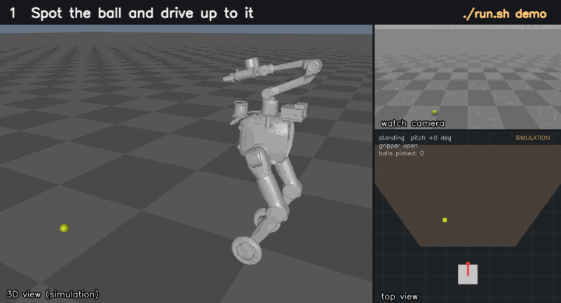
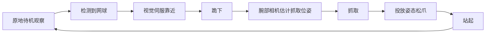

<h1 align="center">TRON2 视觉抓取</h1>

<p align="center">
  <b>看见目标，走过去，跪下，捡起来。</b><br>
  面向逐际动力 LimX TRON2 的视觉引导移动抓取，全程只用 CPU。
</p>

<p align="center">
  <a href="https://github.com/limxdynamics/tron2_visual_grasp/actions/workflows/ci.yml"></a>
  
  
  
  
  
</p>

<p align="center">
  <a href="./README_zh.md">简体中文</a> | <a href="./README.md">English</a>
</p>

<p align="center">
  
  <br><sub>无硬件演示模式（<code>./run.sh demo</code>）下的一次完整抓取，使用 TRON2 官方模型模拟。</sub>
</p>

TRON2 用腕部的 RealSense D405 观察地面，自己走到目标跟前，跪下，用同一个相机锁定抓取位姿，
抓起来投放后再站起来，回到观察状态等待下一个。当前内置的第一个目标是**网球**，后续会支持更多物体。

## ✨ 亮点

- **端到端移动抓取，循环执行**：原地观察 → 视觉伺服靠近 → 跪下 → 腕部相机抓取 → 投放 → 站起 → 继续下一个。
- **不需要 GPU，也不需要神经网络**：检测器是纯 OpenCV（HSV 颜色 + 圆形轮廓筛选），笔记本或 Jetson 的 CPU 就能跑，不用下载任何模型。
- **闭环抓取**：机械臂运动过程中腕部相机持续检测，并朝最新位置修正，球滚动一点也能抓到。
- **一条命令完成手眼标定**：机械臂围绕 ArUco 标定板自动走 26 个位姿、自动求解，再用一条命令验证结果。
- **网页实时控制台**：浏览器里看相机画面、任务状态，一键 Stop，还能现场拖动 HSV / 曝光滑条调检测参数。
- **无硬件也能体验**：`./run.sh demo` 在模拟的 TRON2 和腕部相机上跑完整任务，浏览器里就能看。
- **硬件解耦**：机器人和相机驱动各有统一接口，目前支持 TRON2 和 AgileX PiperX 机械臂。

## 🚀 快速上手

### 没有机器人也能体验

不需要 TRON2 和相机：演示模式用模拟的机器人和腕部相机，跑的是真实的任务代码。

```bash
git clone https://github.com/limxdynamics/tron2_visual_grasp.git
cd tron2_visual_grasp
conda env create -f environment.yml    # 创建名为 tron2_visual_grasp 的环境
./run.sh demo                          # 然后浏览器打开 http://localhost:8888/
```

网页控制台会同时显示 TRON2 的 3D 视图、场景俯视图和渲染出的腕部相机画面。3D 视图用的是 [tron2-robot-description](https://github.com/limxdynamics/tron2-robot-description) 里的官方模型，首次运行时自动下载，约 50 MB。模拟机器人会先发现网球，走过去、跪下，机械臂一边追踪一边把球抓起来，然后站起来去找下一个球，直到你点 **Stop** 或按 Ctrl+C。检测、抓取位姿求解和任务流程都是真机上跑的同一套代码，只有驱动是模拟的（简单运动学，没有物理仿真）。`./run.sh demo --cycles 3` 抓完 3 个球后自动退出。

### 在真机上运行

> [!WARNING]
> 本项目会驱动真实机器人，大多数命令**一连上就会让机器人运动**。请先阅读[安全须知](#安全须知)，并让急停始终处于随手可及的位置。

```bash
./run.sh pose       # 1. 确认能连上机器人（只读）
./run.sh detect     # 2. 确认网球能被稳定识别（机器人不动）
./run.sh calib      # 3. 手眼标定（首次必做）
./run.sh dry-run    # 4. 确认抓取点合理（机器人不动）
./run.sh grasp      # 5. 实际抓取
```

运行 `dry-run` 或 `grasp` 时，浏览器打开 `http://<主机IP>:8888` 即可查看相机画面并实时调参。

## 🧭 工作原理



1. **观察**：机械臂保持前视姿态，检测器逐帧扫描。
2. **靠近**：2D 视觉伺服驱动底盘，直到目标落在画面中的预定位置。
3. **跪下低头**：机器人跪下并前倾身体，让腕部相机从上方看到目标。
4. **抓取**：深度 + 手眼标定得到目标在机器人基座系下的抓取位姿，机械臂一边跟踪一边靠近。
5. **投放、循环**：在投放姿态松爪，站起后回到观察状态。

## 🗺️ 路线图

- [x] TRON2 + 腕部 D405 网球拾取
- [ ] 支持网球以外的更多物体

欢迎在 [issues](../../issues) 里提想法和需求。

## 🔗 LimX Dynamics 相关项目

| 项目 | 简介 |
|------|------|
| [tron2_env](https://github.com/limxdynamics/tron2_env) | TRON2 的 Gym 风格运行时：WebSocket 通信、运动控制、多相机观测 |
| [tron2_openpi](https://github.com/limxdynamics/tron2_openpi) | 面向 TRON2 操作任务的 OpenPI（π0.5）策略部署与微调 |
| [TRON2_YG_LAB](https://github.com/limxdynamics/TRON2_YG_LAB) | 带 6 自由度机械臂和夹爪的 TRON2A 的 Isaac Lab 强化学习训练 |
| [tron2-robot-description](https://github.com/limxdynamics/tron2-robot-description) | TRON2A 的 URDF / MJCF / USD 模型 |

---

## 📖 文档

- [硬件](#硬件)
- [安全须知](#安全须知)
- [安装](#安装)
- [命令](#命令)
- [网球检测](#网球检测)
- [手眼标定](#手眼标定)
- [抓取任务](#抓取任务)
- [目录结构](#目录结构)
- [常见问题](#常见问题)
- [已知限制](#已知限制)
- [支持与贡献](#支持与贡献)
- [许可证与致谢](#许可证与致谢)

### 硬件

| 组件 | 型号 |
|------|------|
| 机器人 | TRON2（WebSocket 上层接口，默认 `10.192.1.2:5000`） |
| 夹爪 | AgxGripper |
| 相机 | Intel RealSense D405（腕部，USB 3.0） |
| 主机 | Ubuntu 22.04（x86_64 或 Jetson） |

首次使用相机如遇权限问题，安装 Intel 提供的 RealSense udev 规则后重新插拔相机：

```bash
sudo curl -fsSL -o /etc/udev/rules.d/99-realsense-libusb.rules \
  https://raw.githubusercontent.com/IntelRealSense/librealsense/v2.58.4/config/99-realsense-libusb.rules
sudo udevadm control --reload-rules && sudo udevadm trigger
```

### 安全须知

本项目会驱动真实机器人。运行 `dry-run`、`pose`、`detect` 以外的命令前，请先读完本节。

- **软件没有急停功能。** Ctrl+C 和调试网页上的 Stop 按钮都不是急停。请让机器人自带的急停始终处于随手可及的位置，并确保工作区内无人。
- **命令连上机器人后立即运动，不会询问确认。** `grasp` 一启动就把机械臂移到 `mission.watch_joints`；`home` 移到指定姿态；`calib` 和 `verify` 会以当前位姿为中心，让手腕绕标定板依次走最多 26 个位姿（倾斜最多约 0.22 rad，平移最多约 0.12 m）。
- **`config/default.yaml` 是我们在自己机器人上调出的现场参数，其中几项接近硬件上限**：`robot.tron2.speed_percent: 100`、`robot.tron2.joint_speed_rad_s: 3.0`（机械臂关节速度上限约 3.1 rad/s），手腕跟踪最高 0.8 m/s、3.0 rad/s（`grasp_pipeline.grasp.tracking`），底盘靠近最高 0.6 m/s、0.7 rad/s（`mission.approach.control`），以及 `mission.repeat: true`（任务会一直循环，直到被停止）。首次运行请先调低。
- **底盘会自主驶向检测器认定的目标。** 检测只看颜色和形状，任何黄绿色的圆形物体都可能触发靠近，也没有任何障碍物或人员检测。只能在清空的场地中运行。
- **部分参数只适用于我们的机器人。** 首次运行前请检查 `robot.tron2.accid`（设为 `null` 则从机器人自动获取）、`robot.tron2.prepare_ee_pose`、`calibration.aruco.marker_length_m`、`mission.watch_joints` 和 `mission.drop_joints`。
- **TRON2 驱动内置的防护**（[drivers/robot/tron2_driver.py](drivers/robot/tron2_driver.py)）：拒绝下发非有限值（NaN / inf）的目标；底盘速度一律限制在 `robot.tron2.max_twist_mps` / `max_twist_rps` 以内；机器人回复的数据格式异常时直接忽略，不会当作当前位姿使用；位姿反馈中断时暂停机械臂指令流；连接断开时报错停止。这些只是软件层面的防护，不能代替急停。

#### 停止方式

- **Ctrl+C** 会很快生效，并执行收尾：
  - `grasp`：先给底盘发送停止指令；如果已经发出下跪请求且尚未站起，就把机械臂收到 `robot.tron2.park_joints` 后站起（机械臂收不回去时不会站起，保持跪姿）；最后把机械臂收到收臂位（已在则跳过）并断开连接。收尾过程中再按一次 Ctrl+C 会放弃收尾，机器人可能保持跪姿。
  - `calib` / `verify`：机械臂收到收臂位并断开连接；`calib` 随后用已采集的样本求解。
  - `home`：停止下发指令，机械臂停在当前位置。
- **网页 Stop 按钮**（以及 `--display` 窗口中的 `q` / Esc）只在下一个检查点生效，即原地观察、靠近、腕部相机检测、跟踪抓取这几个阶段。下跪、俯仰、站起及其等待（最长为 `robot.tron2.posture_timeout_s` 加上 `mission.posture` 中的各项等待时间）、机械臂运动和投放过程都不会被打断。停止后 `grasp` 执行与 Ctrl+C 相同的收尾。
- **`kill <pid>`（SIGTERM）或关闭终端** 会立即结束进程，不做任何收尾，机械臂和身体保持原状（可能仍是跪姿）。`kill -INT <pid>` 会执行与 Ctrl+C 相同的收尾，除非进程启动时 SIGINT 被忽略（例如在非交互脚本中用 `&` 启动）。
- 指令停止下发后，机器人的状态取决于控制器：按 [drivers/robot/tron2_driver.py](drivers/robot/tron2_driver.py) 中的说明，机械臂会在 0.2 s 指令超时后锁定保持，`request_twist` 中断后底盘停止。请在你的机器人上确认这一点。

#### 调试网页

`grasp`、`dry-run`、`calib`、`verify` 会在 8888 端口提供调试网页，监听所有网卡，且没有任何认证。能访问该端口的人都可以查看相机画面、点击页面按钮（Stop；标定时的采样 / 结束）；在 `grasp` / `dry-run` 中还能修改 HSV 阈值和相机曝光，从而改变机器人驶向的目标。请只在可信网络中使用，或用 `--web-port 0` 关闭（`grasp` / `dry-run` 也可设置 `mission.web_port: 0`）。

### 安装

```bash
git clone https://github.com/limxdynamics/tron2_visual_grasp.git
cd tron2_visual_grasp
conda env create -f environment.yml    # 创建名为 tron2_visual_grasp 的环境
```

`run.sh` 通过 `conda info --base` 找到 `tron2_visual_grasp` 环境；也可以用 `TVG_PYTHON=/path/to/python` 指定其他解释器。

### 命令

所有功能通过 `./run.sh <命令>` 启动，不要直接运行 `python scripts/...`。

> [!WARNING]
> 除 `demo`、`dry-run`、`pose`、`detect` 外，命令一连上机器人就会运动，不会询问确认。请先阅读[安全须知](#安全须知)，并让急停始终处于随手可及的位置。

| 命令 | 作用 |
|------|------|
| `demo [--cycles N]` | 无硬件演示：在模拟的 TRON2 和腕部相机上跑完整的 `grasp` 任务（不需要机器人和相机） |
| `pose [--watch]` | 打印关节角与 TCP 位姿（只读） |
| `detect` | 相机 + 网球检测预览，左键点击读取深度 |
| `home [--pose park\|ready\|watch] [--open-gripper]` | 机械臂回到休息位 |
| `calib [--manual]` | 手眼标定采集与求解 |
| `verify` | 手眼标定验证 |
| `dry-run` | 只跑感知与抓取位姿估计，不动机器人 |
| `grasp` | 原地观察 → 靠近 → 跪下抓取 → 松爪 → 站起，循环执行 |
| `shell <脚本>` | 用项目环境运行任意脚本 |

### 网球检测

检测器在 [utils/opencv_tennis.py](utils/opencv_tennis.py)，参数集中在 `config/default.yaml` 的 `detection.tennis`：

| 参数 | 说明 |
|------|------|
| `hsv_lower` / `hsv_upper` | 黄绿色毛毡的 HSV 范围（H 0–179，S/V 0–255） |
| `min_area_px` / `max_area_fraction` | 过滤过小噪点与大块背景 |
| `min_aspect_ratio` / `min_circularity` / `min_solidity` / `min_circle_fill` | 形状必须接近圆形 |
| `min_colour_fraction` | 轮廓内颜色占比 |
| `max_det` | 每帧最多保留的候选数 |

`detection.conf_threshold` 是上述形状指标的平均分阈值。贴着画面边缘的球会被丢弃，因为轮廓不完整时中心和尺寸不可靠。

**现场调参**：`grasp` / `dry-run` 的调试页（`http://<主机IP>:8888`）可以实时拖动 HSV 上下限和相机曝光。调节只对当前进程有效，确认合适后把数值写回配置文件。

### 手眼标定

1. 按 100% 原始尺寸打印 [aruco100x100.pdf](aruco100x100.pdf)（不要选“适合页面”缩放），其中是 OpenCV `DICT_4X4_50` 的 0 号标记，黑色方块边长 100 mm。平放在相机视野内，用卡尺量黑框外边长，填入 `calibration.aruco.marker_length_m`（随附配置中的 0.096 m 是我们自己那张打印件的实测值）。
2. 运行 `./run.sh calib`：机械臂以当前位姿为中心自动遍历 26 个位姿并采样（≥5 个样本即可求解，建议 ≥15）；加 `--manual` 改为手动拖动示教（仅 PiperX；TRON2 不支持拖动示教）。结果保存到 `config/calibration/realsense_d405/hand_eye.npz`。
3. 运行 `./run.sh verify` 检查标定结果。
4. 抓取仍有固定偏差时，微调 `calibration.hand_eye_compensation_m` 的 x / y / z（米）。

### 抓取任务

对应命令 `grasp`。

由 [scripts/squat_grasp.py](scripts/squat_grasp.py) 实现，主要配置在 `mission`：

| 配置 | 说明 |
|------|------|
| `watch_joints` | 观察姿态下的机械臂关节角 |
| `detect_on_frames` / `detect_window_frames` | 连续若干帧看到球才开始动作 |
| `approach` | 视觉伺服靠近；`enabled: false` 时底盘不动，球必须已经在下蹲后的可达范围内 |
| `posture` | WF 跪下/站起后的稳定等待时间、身体俯仰角及俯仰稳定等待时间 |
| `drop_joints` | 站起前松爪投放的姿态；`null` 时在收臂姿态松爪 |
| `repeat` | 抓完后回到观察状态继续 |
| `web_port` | 调试网页端口 |

抓取位姿参数在 `grasp_pipeline.grasp`（预抓取偏移、插入深度、最低高度、夹爪朝向等）。

下蹲使用 `request_wf_stand_kneel`，`data.action` 分别为 `kneel`（跪下）和 `stand`（站起），不再发送高度步进命令。
必须等跪好（`kneel_dwell_s`）后才能低头：先发送俯仰复位清掉上一轮的设定值，等待 `pitch_reset_dwell_s` 后，再设置 `body_pitch_rad` 并等待 `pitch_dwell_s`。俯仰是相对量，站起只会把身体摆正、不会清零设定值，不复位的话第二轮俯仰不会动。站起前不再单独发送恢复俯仰命令。
请求使用 `robot.tron2.accid`（须与机器人 `notify_robot_info` 推送的一致；设为 `null` 则自动获取）、每次新生成的 GUID 和当前毫秒时间戳。
驱动等待相同 GUID 的 `response_wf_stand_kneel`，仅 `data.result: success` 视为成功；
拒绝或超时（`robot.tron2.posture_timeout_s`，默认 30 秒）会报错。
在跪姿下先投放（转到投放姿态、松爪），再收臂、站起。
站起动作会切走本程序对机械臂的控制：站起后若关节动作没有响应，驱动会重连 WebSocket 并重试，最长 `robot.tron2.arm_reacquire_timeout_s`（默认 15 秒）。
跪下请求失败或超时时，退出清理也会尝试站起。
两个姿态接口都不反馈“动作已到位”：抓取只在等满 `kneel_dwell_s` + `pitch_dwell_s` 后开始，请在实机上调好这两个时间，并重新核对新姿态下的抓取高度限制。

常用参数：`--target-class <类别>`、`--display`（本地预览窗口）、`--web-port <端口>`（`0` 关闭网页）、`--grasp-timeout <秒>`、`--cycles <n>`（跑 n 轮后退出）、`--config <路径>`。设置环境变量 `GRASP_DEBUG=0` 可关闭每次求解抓取位姿时打印的坐标变换明细。

**模拟模式（`demo`）**：`--sim`（`./run.sh demo` 自动带上）会换用 [drivers/sim/](drivers/sim/) 下的驱动：
- **腕部相机：** 按机械臂位姿渲染地面和网球，同时输出彩色图和深度图。
- **TRON2：** 运动学模型，包括底盘速度、跪下/站起、躯干俯仰、机械臂（piper_x 正运动学）和夹爪。TCP（两指尖中点）到达球的位置即判定抓取成功。机身尺寸取自 WFYG_TRON2A 模型。
- **3D 视图：** [drivers/sim/view3d.py](drivers/sim/view3d.py) 用 MuJoCo 摆放 WFYG_TRON2A 模型，只做运动学和渲染，不做物理仿真。腿部按"轮子贴地"求解；跪姿是折腿、膝盖着地的示意，并非真机的 WF 跪姿。模型按固定提交下载到 `~/.cache/tron2_visual_grasp`，也可以用 `TVG_ROBOT_MODEL` 指定本地的 `robot.xml`。没有 GPU 时每帧可能要 1 秒左右；没有显示器的机器请设置 `MUJOCO_GL=egl` 或 `osmesa`，或者用 `xvfb-run` 运行。用 `sim.view3d.enabled: false` 可以关闭。
- **手眼：** 一个固定变换，随仓库提供，见 `config/calibration/sim_d405/hand_eye.npz`。

配置在 `sim` 一节，其中 `sim.overrides` 只在演示模式下覆盖其余配置（缩短姿态等待时间）。模拟器没有动力学、打滑、延迟，除少量图像噪点外也没有传感器噪声，所以演示能跑通不代表真机参数已经调好。

### 目录结构

```
config/default.yaml      全部参数（唯一配置来源）
calibration/             ArUco 位姿与手眼标定求解
drivers/camera/          相机驱动（RealSense）
drivers/robot/           机器人驱动（TRON2 / PiperX）
drivers/sim/             ./run.sh demo 用的模拟 TRON2、相机与 3D 视图
tests/                   无需硬件的测试（pytest），CI 中运行
utils/opencv_tennis.py   网球检测器
utils/ordinary_grasp.py  抓取位姿估计
utils/visual_servo.py    视觉伺服靠近
utils/web_debug.py       调试网页（状态、相机画面、HSV/曝光滑条）
scripts/                 各命令的入口脚本
run.sh                   启动器
```

### 常见问题

| 现象 | 处理 |
|------|------|
| 连接 TRON2 超时 | 检查 `robot.tron2.robot_ip` / `port`，主机需与机器人在同一网段 |
| 识别不到网球 / 误识别 | 用 `./run.sh detect` 观察，在 `dry-run` 调试网页上调整 HSV 和曝光，再写回 `detection.tennis` |
| 标定时提示 `Marker not in view` | 把标定板移到相机视野内 |
| 抓取位置整体偏移 | 重新标定，或调整 `calibration.hand_eye_compensation_m` |
| 球在边缘时不触发 | 正常行为：贴边的球会被丢弃，靠近后会重新识别 |
| 找不到 conda 环境 | 用 `conda env create -f environment.yml` 创建，或设置 `TVG_PYTHON=/path/to/python` |

### 已知限制

- 检测基于传统的 HSV 颜色和圆形轮廓筛选：光照变化后需要重新调参，其他黄绿色圆形物体也可能被当成网球。
- 没有障碍物、人员或台阶边缘检测；靠近阶段会直接驶向目标。
- TRON2 夹爪不反馈开口宽度，空抓也会被报告为成功。
- 下跪、站起和身体俯仰都没有完成反馈，任务只能等待固定时间（见[抓取任务](#抓取任务)）。
- `grasp` 和 `pose` 只支持 TRON2；`home`、`calib`、`verify` 也可用于通过 CAN 连接的 PiperX（`robot.type: piperx`）。

### 支持与贡献

- **维护状态**：由 LimX Dynamics 作为开源演示项目维护，社区支持按尽力而为的方式提供，不承诺固定响应时间。
- **问题反馈、功能建议、使用咨询**：在本仓库提 issue，请附上所用的提交号、机器人型号与固件版本，以及相关日志。
- **安全漏洞**：请勿提公开 issue，按 [LimX Dynamics 安全策略](https://github.com/limxdynamics/.github/blob/main/SECURITY.md) 私下报告。
- **贡献代码**：见[贡献指南](https://github.com/limxdynamics/.github/blob/main/CONTRIBUTING.md)；小修小补以外的改动，请先提 issue 讨论。
- **测试与 CI**：每次推送和 PR 都会运行无需硬件的测试（合成图像上的感知测试，以及 TRON2 驱动对接上层协议模拟服务的测试）。本地运行：`pip install -r tests/requirements.txt && python -m pytest tests`；涉及运动的改动，还请在真机上用 `./run.sh dry-run` 和 `./run.sh detect` 验证。

### 许可证与致谢

本项目以 Apache License 2.0 发布，见 [LICENSE](LICENSE) 与 [NOTICE](NOTICE)。

相机驱动、手眼标定和抓取几何的部分代码基于 Seeed Studio 的 [reBot-DevArm-Grasp](https://github.com/Seeed-Projects/reBot-DevArm-Grasp)（MIT）修改，感谢 Seeed 团队；涉及的文件清单与上游许可全文见 [NOTICE](NOTICE)。

依赖需单独安装，并各自遵循其许可证；例如 pyAgxArm 和 python-can 为 LGPL-3.0。`./run.sh demo` 用到的 3D 模型在运行时从 [tron2-robot-description](https://github.com/limxdynamics/tron2-robot-description)（Apache-2.0）下载，不包含在本仓库中。

---

<p align="center">如果这个项目对你有帮助，点个 ⭐ 能让更多人看到它。</p>
